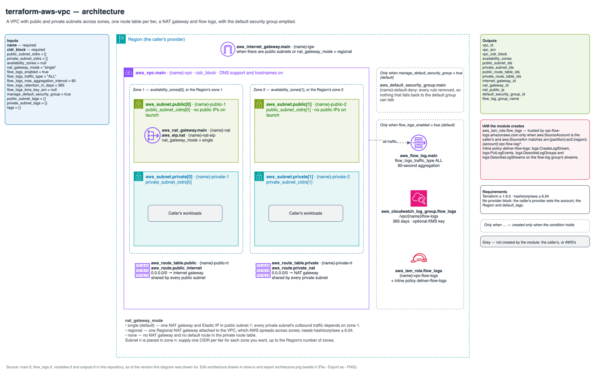

# Reference: names, tags and IAM

Every resource the module can create, when it is created, and the names it gets.
`<name>` is `var.name`; `<n>` counts from 1. Every resource also gets `var.tags`; a
`Name` key in `var.tags` overrides the generated `Name` tag on every resource.

## Diagram

Source: [`architecture.drawio`](architecture.drawio).

## Resources

| Resource | Created when | Name or `Name` tag |
| --- | --- | --- |
| `aws_vpc.main` | Always | `<name>-vpc` |
| `aws_default_security_group.main[0]` | `manage_default_security_group` | `<name>-default-deny`; every rule removed |
| `aws_subnet.public[*]` | One per `public_subnet_cidrs` entry | `<name>-public-<n>`, tag `Tier = public`, plus `public_subnet_tags` |
| `aws_subnet.private[*]` | One per `private_subnet_cidrs` entry | `<name>-private-<n>`, tag `Tier = private`, plus `private_subnet_tags` |
| `aws_internet_gateway.main[0]` | Public subnets exist, or `nat_gateway_mode = "regional"` | `<name>-igw` |
| `aws_eip.nat[0]` | `nat_gateway_mode = "single"` | `<name>-nat-eip` |
| `aws_nat_gateway.main[0]` | `nat_gateway_mode` is not `"none"` | `<name>-nat` |
| `aws_route_table.public[0]`, `aws_route.public_internet[0]` | Public subnets exist | `<name>-public-rt`; route `0.0.0.0/0` to the internet gateway |
| `aws_route_table.private[0]` | Private subnets exist | `<name>-private-rt` |
| `aws_route.private_nat[0]` | Private subnets and a NAT gateway exist | Route `0.0.0.0/0` to the NAT gateway |
| `aws_route_table_association.public[*]`, `.private[*]` | One per subnet | — |
| `aws_cloudwatch_log_group.flow_logs[0]` | `flow_logs_enabled` | Log group `/vpc/<name>/flow-logs`, tag `<name>-flow-logs` |
| `aws_iam_role.flow_logs[0]` | `flow_logs_enabled` | Role `<name>-vpc-flow-logs` (tags: `var.tags` only) |
| `aws_iam_role_policy.flow_logs[0]` | `flow_logs_enabled` | Inline policy `deliver-flow-logs` |
| `aws_flow_log.main[0]` | `flow_logs_enabled` | `<name>-flow-log` |

Subnet `<n>` of each tier is placed in the `<n>`-th entry of `availability_zones`, or
of the Region's zones that need no opt-in, sorted by name.

## IAM granted by the module

The flow-log delivery role is the only IAM the module creates.

| | |
| --- | --- |
| Trusted principal | `vpc-flow-logs.amazonaws.com`, only when `aws:SourceAccount` is the caller's account and `aws:SourceArn` matches `arn:<partition>:ec2:<region>:<account>:vpc-flow-log/*` |
| Actions | `logs:CreateLogStream`, `logs:PutLogEvents`, `logs:DescribeLogGroups`, `logs:DescribeLogStreams` |
| Resource | `<flow-log group ARN>:*` |

## Permissions the caller needs

To apply the module, the caller's credentials need EC2 VPC, subnet, gateway, route,
Elastic IP, flow-log and security-group permissions; IAM role and inline-policy
management for the one role above (including `iam:PassRole` on it); CloudWatch Logs
log-group management; `ec2:DescribeAvailabilityZones`; and `sts:GetCallerIdentity`.
A regional NAT gateway also needs `ec2:DescribeAvailabilityZones` at apply time.

## Requirements

| | Minimum | Why |
| --- | --- | --- |
| Terraform | 1.9.0 | Variable validations that refer to other variables |
| `hashicorp/aws` | 6.24 | Regional NAT gateways (`availability_mode`) |

Inputs and outputs are listed in the [README](../../README.md#inputs).
